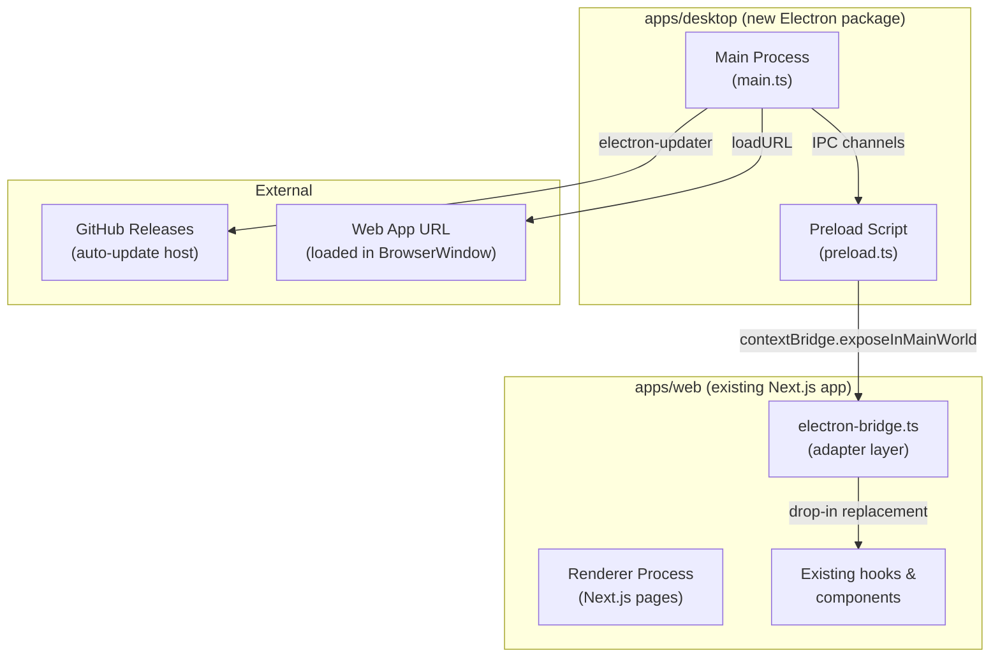
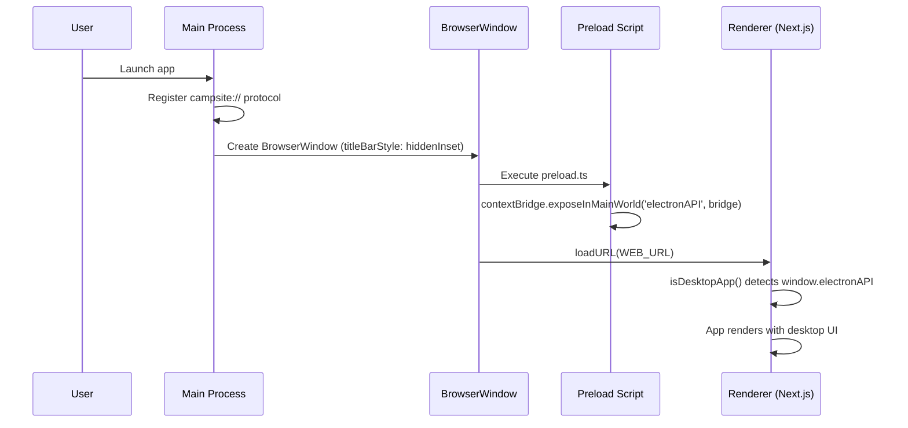
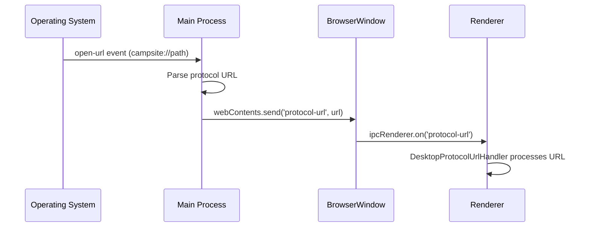
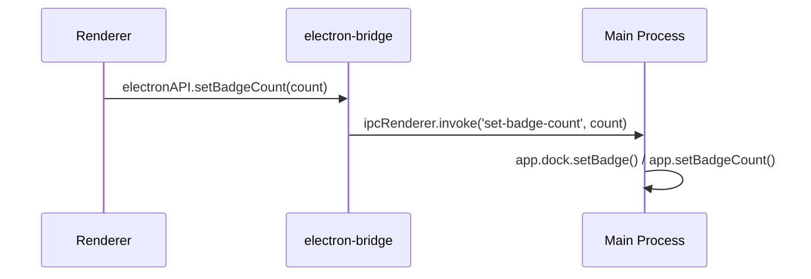

# Design Document: Electron Wrapper (Replace Todesktop)

## Overview

This feature replaces the paid Todesktop service ($100/year) with a self-managed Electron wrapper for the Campsite desktop app. The existing Next.js web app (`apps/web`) is loaded inside a BrowserWindow, preserving all current desktop functionality: custom protocol handling (`campsite://`), native window management, dock badge counts, screen share source picking, AV permission checks, app menu customization, and OAuth deep-link interception.

The migration creates a new `apps/desktop` package in the monorepo containing the Electron main process, a preload script that exposes a bridge API on `window.electronAPI`, and an adapter layer in the renderer that maps the bridge API to the existing `@todesktop/client-core` call sites. The build and distribution pipeline uses `electron-builder` for packaging and `electron-updater` for auto-updates, hosted via GitHub Releases.

## Architecture



## Sequence Diagrams

### App Startup & Window Creation



### Protocol URL Handling (e.g. campsite://auth/desktop)



### Desktop Notification Badge Update



## Components and Interfaces

### Component 1: Main Process (`apps/desktop/src/main.ts`)

**Purpose**: Electron main process — creates windows, registers protocol handler, manages IPC, handles auto-updates.

**Interface**:
```typescript
// IPC channel handlers registered in main process
interface MainProcessIPC {
  // Window management
  'window:maximize': () => void
  'window:minimize': () => void
  'window:restore': () => void
  'window:close': () => void
  'window:blur': () => void
  'window:show': (ref?: string) => void
  'window:create': (options: BrowserWindowOptions) => string // returns window ref ID

  // App operations
  'app:set-badge-count': (count: number) => void
  'app:dock-set-badge': (text: string) => void
  'app:get-capture-sources': (options: CaptureSourceOptions) => CaptureSource[]
  'app:quit': () => void

  // Window queries
  'window:get-all': () => { id: string }[]

  // Navigation
  'webcontents:go-back': () => void
  'webcontents:go-forward': () => void
  'webcontents:can-go-back': () => boolean
  'webcontents:can-go-forward': () => boolean
  'webcontents:load-url': (ref: string, url: string) => void

  // System
  'system:get-media-access-status': (mediaType: string) => string
  'system:ask-for-media-access': (mediaType: string) => boolean
  'system:open-external': (url: string) => void

  // App menu
  'app-menu:add': (menu: string, label: string, accelerator?: string) => void
  'app-menu:refresh': () => void
}
```

**Responsibilities**:
- Create and manage BrowserWindow instances
- Register `campsite://` (or `campsite-dev://`) custom protocol
- Handle `open-url` events and forward to renderer via IPC
- Manage dock badge (macOS) and taskbar badge (Windows)
- Enumerate screen capture sources via `desktopCapturer`
- Provide system preferences access (media permissions)
- Build and manage application menu
- Handle auto-updates via `electron-updater`

### Component 2: Preload Script (`apps/desktop/src/preload.ts`)

**Purpose**: Securely exposes a subset of Electron APIs to the renderer via `contextBridge`.

**Interface**:
```typescript
// Exposed on window.electronAPI via contextBridge
interface ElectronBridgeAPI {
  // Window
  windowMaximize: () => Promise<void>
  windowMinimize: () => Promise<void>
  windowRestore: () => Promise<void>
  windowClose: () => Promise<void>
  windowBlur: () => Promise<void>
  windowShow: (ref?: string) => Promise<void>
  windowCreate: (options: WindowCreateOptions) => Promise<string>
  getAllWindows: () => Promise<{ id: string }[]>

  // App
  quit: () => Promise<void>
  setBadgeCount: (count: number) => Promise<void>
  dockSetBadge: (text: string) => Promise<void>
  getCaptureSources: (options: CaptureSourceOptions) => Promise<CaptureSource[]>
  quit: () => Promise<void>

  // Navigation
  goBack: () => Promise<void>
  goForward: () => Promise<void>
  canGoBack: () => Promise<boolean>
  canGoForward: () => Promise<boolean>
  loadURL: (ref: string, url: string) => Promise<void>

  // System
  getMediaAccessStatus: (mediaType: string) => Promise<string>
  askForMediaAccess: (mediaType: string) => Promise<boolean>
  openExternal: (url: string) => Promise<void>

  // App menu
  addMenuItem: (menu: string, label: string, accelerator?: string) => Promise<void>
  refreshMenu: () => Promise<void>

  // Events (main → renderer)
  onProtocolURL: (callback: (url: string) => void) => () => void
  onNavigate: (callback: () => void) => () => void
  onActivate: (callback: () => void) => () => void

  // Platform info
  platform: 'darwin' | 'win32' | 'linux'
}
```

**Responsibilities**:
- Use `contextBridge.exposeInMainWorld` to safely expose IPC calls
- Wrap all `ipcRenderer.invoke` calls with typed functions
- Provide event listener registration for main→renderer events
- Expose platform information

### Component 3: Electron Bridge Adapter (`apps/web/utils/electron-bridge.ts`)

**Purpose**: Drop-in replacement module that maps the existing `@todesktop/client-core` API surface to `window.electronAPI` calls. Existing components import from this module instead of `@todesktop/client-core`.

**Interface**:
```typescript
// Mirrors the @todesktop/client-core API surface used in the codebase
export const app: {
  dock: {
    setBadge: (text: string) => Promise<void>
  }
  setBadgeCount: (count: number) => Promise<void>
  getCaptureSources: (options: CaptureSourceOptions) => Promise<CaptureSource[]>
  on: (event: string, callback: (...args: any[]) => void) => void
  once: (event: string, callback: (reset: () => void) => void) => void
}

export const nativeWindow: {
  maximize: () => Promise<void>
  minimize: () => Promise<void>
  restore: () => Promise<void>
  blur: () => Promise<void>
  show: (options?: { ref: string }) => Promise<void>
  create: (options: WindowCreateOptions) => Promise<string>
  getWebContents: (options: { ref: string }) => Promise<string>
  getAllWindows: () => Promise<{ id: string }[]>
}

export const webContents: {
  on: (event: string, callback: () => void) => void
  canGoBack: () => Promise<boolean>
  canGoForward: () => Promise<boolean>
  goBack: () => Promise<void>
  goForward: () => Promise<void>
  loadURL: (options: { ref: string }, url: string) => Promise<void>
}

// Re-export CaptureSource type for consumers that import it from @todesktop/client-core/app
export type { CaptureSource } from './electron-bridge-types'

export const systemPreferences: {
  getMediaAccessStatus: (mediaType: string) => Promise<string>
  askForMediaAccess: (mediaType: string) => Promise<boolean>
}

export const appMenu: {
  add: (menu: string, label: string, callback: () => void, options?: { accelerator: string }) => Promise<void>
  refresh: () => Promise<void>
}

export const os: {
  openURL: (url: string) => void
}

export const newApp: {
  on: (event: string, callback: () => void) => Promise<() => void>
}
```

**Responsibilities**:
- Provide API-compatible replacements for every `@todesktop/client-core` import used in the codebase
- Delegate all calls to `window.electronAPI` (the preload bridge)
- Handle event registration/deregistration patterns (especially `app.once` with reset callbacks)
- Gracefully no-op when not running in Electron (browser fallback)

## Data Models

### Window Reference Tracking

```typescript
// Main process tracks created windows by ref ID
interface WindowRef {
  id: string                    // UUID assigned at creation
  browserWindow: BrowserWindow  // Electron BrowserWindow instance
  parentId?: string             // Parent window ref (for call windows)
}

// Maintained in main process memory
type WindowRegistry = Map<string, WindowRef>
```

### Capture Source (Screen Share)

```typescript
// Matches existing CaptureSource from @todesktop/client-core/app
interface CaptureSource {
  id: string
  name: string
  thumbnail: string  // base64 data URL
}

interface CaptureSourceOptions {
  types: ('window' | 'screen')[]
  thumbnailSize: { width: number; height: number }
}
```

### Auto-Update Configuration

```typescript
interface UpdateConfig {
  provider: 'github'
  owner: string       // GitHub org/user
  repo: string        // GitHub repo name
  releaseType: 'release'  // Use GitHub Releases
}
```

**Validation Rules**:
- Window refs must be valid UUIDs
- CaptureSource thumbnails are NativeImage converted to data URLs
- Badge count must be non-negative integer
- Badge text must be a string (macOS dock badge)


## Key Functions with Formal Specifications

### Function 1: createMainWindow()

```typescript
function createMainWindow(): BrowserWindow
```

**Preconditions:**
- Electron `app` is ready (`app.isReady() === true`)
- `WEB_URL` environment variable is set and valid

**Postconditions:**
- Returns a BrowserWindow with `titleBarStyle: 'hiddenInset'` (macOS) or `frame: false` (Windows/Linux)
- Window loads `WEB_URL` in the webContents
- Preload script is attached via `webPreferences.preload`
- `contextIsolation` is `true` and `nodeIntegration` is `false`
- Window has minimum size constraints (minWidth: 800, minHeight: 600)

**Loop Invariants:** N/A

### Function 2: registerProtocolHandler()

```typescript
function registerProtocolHandler(protocol: string): void
```

**Preconditions:**
- `protocol` is a non-empty string matching `campsite` or `campsite-dev`
- Called before `app.isReady()` or during `app.whenReady()`

**Postconditions:**
- App is registered as default handler for `{protocol}://` URLs
- `open-url` events on macOS are captured and forwarded to renderer
- On Windows, `--open-url` command line args are parsed on second-instance

**Loop Invariants:** N/A

### Function 3: handleProtocolURL()

```typescript
function handleProtocolURL(url: string): void
```

**Preconditions:**
- `url` starts with the registered protocol prefix
- At least one BrowserWindow exists

**Postconditions:**
- If URL contains `/calls/join/`: a new call window is created and URL is loaded
- If URL contains `://auth/desktop`: URL is forwarded to main window renderer for auth processing
- Main window is focused (or blurred for call windows per existing behavior)

**Loop Invariants:** N/A

### Function 4: setupAutoUpdater()

```typescript
function setupAutoUpdater(config: UpdateConfig): void
```

**Preconditions:**
- App is packaged (not in development mode)
- `config.owner` and `config.repo` are valid GitHub identifiers

**Postconditions:**
- `electron-updater` checks for updates on app launch and periodically (every 4 hours)
- When update is available: downloads silently in background
- When update is downloaded: installs on next app quit (via `autoUpdater.quitAndInstall()`)
- Update errors are caught and logged (never crash the app)

**Loop Invariants:** N/A

### Function 5: isDesktopApp() (updated detection)

```typescript
function isDesktopApp(): boolean
```

**Preconditions:**
- Called in browser/renderer context (`typeof window !== 'undefined'`)

**Postconditions:**
- Returns `true` if `window.electronAPI` is defined (new Electron bridge)
- Returns `true` if `window.todesktop` is defined (legacy fallback during migration)
- Returns `false` in all other cases (browser, SSR)

**Loop Invariants:** N/A

## Algorithmic Pseudocode

### Main Process Initialization

```typescript
// apps/desktop/src/main.ts

import { app, BrowserWindow, ipcMain, protocol, desktopCapturer, shell, systemPreferences } from 'electron'
import { autoUpdater } from 'electron-updater'
import path from 'path'

const IS_DEV = !app.isPackaged
const PROTOCOL = IS_DEV ? 'campsite-dev' : 'campsite'
const WEB_URL = IS_DEV ? 'http://localhost:3000' : 'https://app.campsite.com'

const windowRegistry = new Map<string, BrowserWindow>()
let mainWindow: BrowserWindow | null = null

// Step 1: Register protocol before app is ready
if (process.defaultApp) {
  if (process.argv.length >= 2) {
    app.setAsDefaultProtocolClient(PROTOCOL, process.execPath, [path.resolve(process.argv[1])])
  }
} else {
  app.setAsDefaultProtocolClient(PROTOCOL)
}

// Step 2: Single instance lock (Windows deep link support)
const gotTheLock = app.requestSingleInstanceLock()
if (!gotTheLock) {
  app.quit()
} else {
  app.on('second-instance', (_event, commandLine) => {
    // Windows: protocol URL comes via command line on second instance
    const url = commandLine.find(arg => arg.startsWith(`${PROTOCOL}://`))
    if (url) handleProtocolURL(url)
    if (mainWindow) {
      if (mainWindow.isMinimized()) mainWindow.restore()
      mainWindow.focus()
    }
  })
}

// Step 3: macOS open-url handler
app.on('open-url', (event, url) => {
  event.preventDefault()
  handleProtocolURL(url)
})

// Step 4: App ready — create window, register IPC, setup auto-update
app.whenReady().then(() => {
  mainWindow = createMainWindow()
  registerIPCHandlers()
  if (!IS_DEV) setupAutoUpdater()
})

app.on('activate', () => {
  // macOS: re-create window when dock icon clicked
  if (BrowserWindow.getAllWindows().length === 0) {
    mainWindow = createMainWindow()
  } else {
    mainWindow?.show()
  }
  // Notify renderer of activate event
  mainWindow?.webContents.send('app:activate')
})

app.on('window-all-closed', () => {
  if (process.platform !== 'darwin') app.quit()
})
```

### IPC Handler Registration

```typescript
function registerIPCHandlers(): void {
  // Window management
  ipcMain.handle('window:maximize', () => {
    BrowserWindow.getFocusedWindow()?.maximize()
  })

  ipcMain.handle('window:minimize', () => {
    BrowserWindow.getFocusedWindow()?.minimize()
  })

  ipcMain.handle('window:restore', () => {
    BrowserWindow.getFocusedWindow()?.restore()
  })

  ipcMain.handle('window:close', () => {
    BrowserWindow.getFocusedWindow()?.close()
  })

  ipcMain.handle('window:blur', () => {
    BrowserWindow.getFocusedWindow()?.blur()
  })

  ipcMain.handle('window:show', (_event, ref?: string) => {
    if (ref && windowRegistry.has(ref)) {
      windowRegistry.get(ref)!.show()
    } else {
      mainWindow?.show()
    }
  })

  ipcMain.handle('window:create', (_event, options: Electron.BrowserWindowConstructorOptions) => {
    const id = crypto.randomUUID()
    const win = new BrowserWindow({
      ...options,
      webPreferences: {
        preload: path.join(__dirname, 'preload.js'),
        contextIsolation: true,
        nodeIntegration: false,
      },
    })
    windowRegistry.set(id, win)
    win.on('closed', () => windowRegistry.delete(id))
    return id
  })

  ipcMain.handle('window:get-all', () => {
    return BrowserWindow.getAllWindows().map((win) => ({
      id: [...windowRegistry.entries()].find(([, w]) => w === win)?.[0] ?? 'main',
    }))
  })

  // App
  ipcMain.handle('app:quit', () => {
    app.quit()
  })

  // Badge
  ipcMain.handle('app:set-badge-count', (_event, count: number) => {
    app.setBadgeCount(count)
  })

  ipcMain.handle('app:dock-set-badge', (_event, text: string) => {
    if (process.platform === 'darwin') {
      app.dock.setBadge(text)
    }
  })

  // Screen capture sources
  ipcMain.handle('app:get-capture-sources', async (_event, options) => {
    const sources = await desktopCapturer.getSources({
      types: options.types,
      thumbnailSize: options.thumbnailSize,
    })
    return sources.map(s => ({
      id: s.id,
      name: s.name,
      thumbnail: s.thumbnail.toDataURL(),
    }))
  })

  // Navigation
  ipcMain.handle('webcontents:go-back', (event) => {
    event.sender.goBack()
  })

  ipcMain.handle('webcontents:go-forward', (event) => {
    event.sender.goForward()
  })

  ipcMain.handle('webcontents:can-go-back', (event) => {
    return event.sender.canGoBack()
  })

  ipcMain.handle('webcontents:can-go-forward', (event) => {
    return event.sender.canGoForward()
  })

  ipcMain.handle('webcontents:load-url', (_event, ref: string, url: string) => {
    const win = windowRegistry.get(ref)
    if (win) win.loadURL(url)
  })

  // System preferences
  ipcMain.handle('system:get-media-access-status', (_event, mediaType: string) => {
    return systemPreferences.getMediaAccessStatus(mediaType as any)
  })

  ipcMain.handle('system:ask-for-media-access', async (_event, mediaType: string) => {
    return systemPreferences.askForMediaAccess(mediaType as any)
  })

  ipcMain.handle('system:open-external', (_event, url: string) => {
    shell.openExternal(url)
  })

  // App menu
  ipcMain.handle('app-menu:add', (_event, menu: string, label: string, accelerator?: string) => {
    // Store menu item config; rebuild menu on refresh
    menuItems.push({ menu, label, accelerator })
  })

  ipcMain.handle('app-menu:refresh', () => {
    rebuildAppMenu()
  })
}
```

### Preload Script

```typescript
// apps/desktop/src/preload.ts
import { contextBridge, ipcRenderer } from 'electron'

contextBridge.exposeInMainWorld('electronAPI', {
  // Window
  windowMaximize: () => ipcRenderer.invoke('window:maximize'),
  windowMinimize: () => ipcRenderer.invoke('window:minimize'),
  windowRestore: () => ipcRenderer.invoke('window:restore'),
  windowClose: () => ipcRenderer.invoke('window:close'),
  windowBlur: () => ipcRenderer.invoke('window:blur'),
  windowShow: (ref?: string) => ipcRenderer.invoke('window:show', ref),
  windowCreate: (options: any) => ipcRenderer.invoke('window:create', options),
  getAllWindows: () => ipcRenderer.invoke('window:get-all'),

  // App
  setBadgeCount: (count: number) => ipcRenderer.invoke('app:set-badge-count', count),
  dockSetBadge: (text: string) => ipcRenderer.invoke('app:dock-set-badge', text),
  getCaptureSources: (options: any) => ipcRenderer.invoke('app:get-capture-sources', options),
  quit: () => ipcRenderer.invoke('app:quit'),

  // Navigation
  goBack: () => ipcRenderer.invoke('webcontents:go-back'),
  goForward: () => ipcRenderer.invoke('webcontents:go-forward'),
  canGoBack: () => ipcRenderer.invoke('webcontents:can-go-back'),
  canGoForward: () => ipcRenderer.invoke('webcontents:can-go-forward'),
  loadURL: (ref: string, url: string) => ipcRenderer.invoke('webcontents:load-url', ref, url),

  // System
  getMediaAccessStatus: (mediaType: string) => ipcRenderer.invoke('system:get-media-access-status', mediaType),
  askForMediaAccess: (mediaType: string) => ipcRenderer.invoke('system:ask-for-media-access', mediaType),
  openExternal: (url: string) => ipcRenderer.invoke('system:open-external', url),

  // App menu
  addMenuItem: (menu: string, label: string, accelerator?: string) =>
    ipcRenderer.invoke('app-menu:add', menu, label, accelerator),
  refreshMenu: () => ipcRenderer.invoke('app-menu:refresh'),

  // Events (main → renderer)
  onProtocolURL: (callback: (url: string) => void) => {
    const handler = (_event: any, url: string) => callback(url)
    ipcRenderer.on('protocol-url', handler)
    return () => ipcRenderer.removeListener('protocol-url', handler)
  },
  onNavigate: (callback: () => void) => {
    const handler = () => callback()
    ipcRenderer.on('did-navigate-in-page', handler)
    return () => ipcRenderer.removeListener('did-navigate-in-page', handler)
  },
  onActivate: (callback: () => void) => {
    const handler = () => callback()
    ipcRenderer.on('app:activate', handler)
    return () => ipcRenderer.removeListener('app:activate', handler)
  },

  // Platform
  platform: process.platform,
})
```

## Example Usage

### Updated `isDesktopApp()` detection

```typescript
// packages/ui/src/hooks/useIsDesktopApp.ts
export function isDesktopApp() {
  if (typeof window === 'undefined') return false
  return !!window.electronAPI || !!window.todesktop
}

export function useIsDesktopApp() {
  return isDesktopApp()
}
```

### Bridge adapter — replacing `@todesktop/client-core` imports

```typescript
// apps/web/utils/electron-bridge.ts
function getAPI(): ElectronBridgeAPI | null {
  if (typeof window !== 'undefined' && window.electronAPI) {
    return window.electronAPI
  }
  return null
}

export const nativeWindow = {
  maximize: () => getAPI()?.windowMaximize() ?? Promise.resolve(),
  restore: () => getAPI()?.windowRestore() ?? Promise.resolve(),
  blur: () => getAPI()?.windowBlur() ?? Promise.resolve(),
  show: (opts?: { ref: string }) => getAPI()?.windowShow(opts?.ref) ?? Promise.resolve(),
  create: (options: any) => getAPI()?.windowCreate(options) ?? Promise.resolve(''),
  getWebContents: (opts: { ref: string }) => Promise.resolve(opts.ref),
  getAllWindows: () => getAPI()?.getAllWindows() ?? Promise.resolve([]),
}

export const app = {
  dock: {
    setBadge: (text: string) => getAPI()?.dockSetBadge(text) ?? Promise.resolve(),
  },
  setBadgeCount: (count: number) => getAPI()?.setBadgeCount(count) ?? Promise.resolve(),
  getCaptureSources: (options: any) => getAPI()?.getCaptureSources(options) ?? Promise.resolve([]),
  on: (event: string, callback: (...args: any[]) => void) => {
    const api = getAPI()
    if (!api) return
    if (event === 'openProtocolURL') {
      api.onProtocolURL((url) => callback(event, { url, preventDefault: () => {} }))
    }
  },
  once: (event: string, callback: (reset: () => void) => void) => {
    const api = getAPI()
    if (!api) return
    if (event === 'registerProtocolUrlListeners') {
      // Immediately invoke — Electron is always ready when renderer loads
      callback(() => {})
    }
  },
}

export const webContents = {
  on: (event: string, callback: () => void) => {
    if (event === 'did-navigate-in-page') {
      getAPI()?.onNavigate(callback)
    }
  },
  canGoBack: () => getAPI()?.canGoBack() ?? Promise.resolve(false),
  canGoForward: () => getAPI()?.canGoForward() ?? Promise.resolve(false),
  goBack: () => getAPI()?.goBack() ?? Promise.resolve(),
  goForward: () => getAPI()?.goForward() ?? Promise.resolve(),
  loadURL: (opts: { ref: string }, url: string) => getAPI()?.loadURL(opts.ref, url) ?? Promise.resolve(),
}

// Re-export CaptureSource type so consumers can swap:
//   import { CaptureSource } from '@todesktop/client-core/app'
// to:
//   import { CaptureSource } from '@/utils/electron-bridge'
export type { CaptureSource }

export const systemPreferences = {
  getMediaAccessStatus: (type: string) => getAPI()?.getMediaAccessStatus(type) ?? Promise.resolve('granted'),
  askForMediaAccess: (type: string) => getAPI()?.askForMediaAccess(type) ?? Promise.resolve(true),
}

export const appMenu = {
  add: async (menu: string, label: string, _callback: () => void, options?: { accelerator: string }) => {
    await getAPI()?.addMenuItem(menu, label, options?.accelerator)
  },
  refresh: () => getAPI()?.refreshMenu() ?? Promise.resolve(),
}

export const os = {
  openURL: (url: string) => { getAPI()?.openExternal(url) },
}

export const newApp = {
  on: (event: string, callback: () => void) => {
    if (event === 'activate') {
      const unsub = getAPI()?.onActivate(callback)
      return Promise.resolve(unsub ?? (() => {}))
    }
    return Promise.resolve(() => {})
  },
}
```

### Migration of an existing component (before/after)

```typescript
// BEFORE: apps/web/components/Titlebar/index.tsx
import { nativeWindow } from '@todesktop/client-core'

// AFTER: apps/web/components/Titlebar/index.tsx
import { nativeWindow } from '@/utils/electron-bridge'
// No other changes needed — API is identical
```

## Correctness Properties

*A property is a characteristic or behavior that should hold true across all valid executions of a system — essentially, a formal statement about what the system should do. Properties serve as the bridge between human-readable specifications and machine-verifiable correctness guarantees.*

### Property 1: Desktop detection correctness

*For any* renderer context, `isDesktopApp()` returns `true` if and only if `window.electronAPI` is defined or `window.todesktop` is defined, and returns `false` when neither is present or when `window` is undefined (SSR).

**Validates: Requirements 1.1, 1.2, 1.3, 1.4**

### Property 2: Window registry lifecycle integrity

*For any* sequence of `nativeWindow.create()` and window close operations, the Window_Registry contains exactly the set of windows that have been created but not yet closed, and `nativeWindow.getAllWindows()` returns references matching that set.

**Validates: Requirements 3.5, 3.6, 3.8**

### Property 3: Protocol URL routing

*For any* valid `campsite://` protocol URL, the Main_Process routes it to the correct destination: URLs containing `/calls/join/` create a new call window, URLs containing `://auth/desktop` are forwarded to the main window, and all other URLs are forwarded to the main window renderer.

**Validates: Requirements 5.2, 5.3, 5.4, 5.5**

### Property 4: Badge delegation correctness

*For any* string value passed to `app.dock.setBadge(text)` and any non-negative integer passed to `app.setBadgeCount(count)`, the Bridge_Adapter delegates to `window.electronAPI.dockSetBadge` and `window.electronAPI.setBadgeCount` respectively with the same argument.

**Validates: Requirements 6.1, 6.2, 6.3**

### Property 5: CaptureSource structure completeness

*For any* CaptureSource returned by `app.getCaptureSources()`, the object contains a non-empty `id`, a non-empty `name`, and a `thumbnail` string that is a valid base64 data URL.

**Validates: Requirement 7.2**

### Property 6: API surface coverage

*For any* import of `@todesktop/client-core` (or its sub-paths `@todesktop/client-core/app`, `@todesktop/client-core/platform`) used in the codebase, there exists a corresponding export in the Bridge_Adapter with an identical call signature.

**Validates: Requirements 12.1, 12.2**

### Property 7: Graceful degradation

*For any* function exported by the Bridge_Adapter, calling it when `window.electronAPI` is undefined resolves without throwing an error, returning sensible defaults (empty arrays, `false`, `void`, or no-op unsubscribe functions).

**Validates: Requirements 13.1, 13.2**

## Error Handling

### Error Scenario 1: Protocol URL with no window

**Condition**: OS delivers a `campsite://` URL but no BrowserWindow exists (app was just launched).
**Response**: Queue the URL. After `mainWindow` is created and `did-finish-load` fires, deliver the queued URL.
**Recovery**: URL is processed once the window is ready.

### Error Scenario 2: Auto-update failure

**Condition**: GitHub Releases is unreachable or the update asset is corrupted.
**Response**: Log the error. Do not show any UI to the user. Retry on next check interval (4 hours).
**Recovery**: App continues running on current version. Next successful check will apply the update.

### Error Scenario 3: IPC call to closed window

**Condition**: Renderer calls `windowShow(ref)` but the referenced window has been closed.
**Response**: `windowRegistry.get(ref)` returns `undefined`. The IPC handler returns gracefully without throwing.
**Recovery**: Caller receives a resolved promise (no-op). The `nativeWindow.show()` call in the bridge catches the error and unsubscribes from the `activate` listener (matching existing Todesktop behavior).

### Error Scenario 4: Screen capture permission denied

**Condition**: User has not granted screen recording permission on macOS.
**Response**: `systemPreferences.getMediaAccessStatus('screen')` returns `'denied'`. The existing `DesktopScreenShareControls` component shows the permissions prompt (no change needed).
**Recovery**: User grants permission in System Preferences. Next `appFocused` check detects the change.

## Testing Strategy

### Unit Testing Approach

- Test `electron-bridge.ts` adapter functions in isolation by mocking `window.electronAPI`
- Verify each bridge function correctly maps to the expected IPC channel
- Test `isDesktopApp()` returns correct values for: `window.electronAPI` present, `window.todesktop` present, neither present, SSR context
- Test protocol URL parsing logic in main process

### Integration Testing Approach

- Use `@electron/test` or Playwright Electron support to launch the packaged app
- Verify BrowserWindow loads the correct URL
- Verify protocol URL handling end-to-end (register protocol → trigger URL → verify renderer receives it)
- Verify badge count updates propagate to the OS
- Verify screen capture source enumeration returns valid sources
- Verify auto-updater initializes without errors in packaged builds

### Manual Testing Checklist

- macOS: Verify `campsite://` deep links open the app and navigate correctly
- macOS: Verify dock badge shows/clears with notification count changes
- Windows: Verify taskbar badge count updates
- Verify screen sharing source picker works in calls
- Verify OAuth flows (Linear, Figma, GitHub) complete successfully via protocol redirect
- Verify back/forward navigation buttons work
- Verify double-click titlebar maximizes window
- Verify auto-update downloads and installs on next restart

## Performance Considerations

- The Electron wrapper loads the same Next.js web app via URL, so renderer performance is unchanged
- Preload script is minimal (~2KB) — no impact on startup time
- IPC calls are async but sub-millisecond for simple operations (badge, window management)
- `desktopCapturer.getSources()` can take 200-500ms — this is called on-demand only (when user clicks screen share)
- Auto-update downloads happen in the background and do not block the UI thread

## Security Considerations

- `contextIsolation: true` and `nodeIntegration: false` — renderer has no direct access to Node.js APIs
- All IPC channels are explicitly defined — no wildcard handlers
- `webPreferences.sandbox: true` should be enabled for additional process isolation
- Protocol URL handler validates URL format before processing
- External URLs are opened via `shell.openExternal()` which delegates to the OS default browser
- Auto-update uses code signing verification (macOS: Apple notarization, Windows: Authenticode)
- CSP headers from the Next.js app are respected in the BrowserWindow

## Dependencies

| Dependency | Purpose | Version |
|---|---|---|
| `electron` | Desktop app framework | ^33.x |
| `electron-builder` | Packaging & distribution | ^25.x |
| `electron-updater` | Auto-update via GitHub Releases | ^6.x |
| `@electron/notarize` | macOS notarization | ^2.x |

### Files Requiring Modification

#### Group A: Import Swap (`@todesktop/client-core` → `@/utils/electron-bridge`)

1. `apps/web/components/Providers/DesktopProtocolUrlHandler.tsx` — imports `app`, `nativeWindow`; also exports `ToDesktopOpenProtocolUrlEvent` interface (rename to `DesktopProtocolUrlEvent`)
2. `apps/web/components/Titlebar/index.tsx` — imports `nativeWindow` for maximize on double-click
3. `apps/web/components/DesktopAppNavigationButtons.tsx` — imports `webContents`; also uses `window.todesktop.contents.goBack()` / `goForward()` directly (must migrate to `webContents.goBack()` / `webContents.goForward()` from bridge adapter)
4. `apps/web/components/NavigationBar/index.tsx` — imports `nativeWindow` for maximize on double-click
5. `apps/web/components/Layout/AppLayout.tsx` — imports `nativeWindow` (drag area expand)
6. `apps/web/components/Providers/AuthProvider.tsx` — imports `appMenu` for File menu item
7. `apps/web/components/Call/ScreenShareControls.tsx` — imports `systemPreferences` for screen recording permission
8. `apps/web/components/Call/DesktopScreenShareSourcesDialog.tsx` — imports `app` and `CaptureSource` type from `@todesktop/client-core/app` sub-path
9. `apps/web/hooks/useGetUnreadNotificationsCount.ts` — imports `app` for dock badge
10. `apps/web/hooks/useAVPermissionState.ts` — imports `systemPreferences` for camera/mic permissions
11. `apps/web/hooks/useCreateDesktopOrBrowserNotification.tsx` — imports `nativeWindow` for restore on notification click; also has comment about ToDesktop auto-setting notification icon (with our own Electron wrapper, we need to set the icon ourselves)
12. `apps/web/hooks/useBindCurrentUserEventOnceInDesktopApp.ts` — imports `app` for `app.once()` pattern
13. `apps/web/hooks/useHandleLinearConnectionSuccess.ts` — imports `app`; also imports `ToDesktopOpenProtocolUrlEvent` from DesktopProtocolUrlHandler
14. `apps/web/hooks/useHandleFigmaConnectionSuccess.ts` — imports `app`; also imports `ToDesktopOpenProtocolUrlEvent` from DesktopProtocolUrlHandler
15. `packages/ui/src/Link/Link.tsx` — imports `os` from `@todesktop/client-core/platform` sub-path
16. `packages/ui/src/Link/utils.ts` — imports `nativeWindow`, `newApp`, `webContents` from `@todesktop/client-core` and `os` from `@todesktop/client-core/platform`
17. `apps/web/pages/[org]/calls/join/[callRoomId]/index.tsx` — imports `nativeWindow`; uses `nativeWindow.getAllWindows()` to detect if current window is the main window

#### Group B: `window.todesktop` Direct References (detection logic)

18. `packages/ui/src/hooks/useIsDesktopApp.ts` — checks `'todesktop' in window && !!window.todesktop`; must update to also check `window.electronAPI`
19. `apps/web/utils/queryClient.ts` — `isDesktopRuntime()` checks `'todesktop' in window`; must update to also check `window.electronAPI`

#### Group C: Configuration & Build Files

20. `apps/web/next.config.js` — CSP `script-src` includes `'todesktop-internal:'`; remove this directive (not needed with native Electron)
21. `apps/web/sentry.client.config.ts` — error filter for `'window.todesktop._.onNotificationCreated is not a function'`; remove this filter
22. `apps/site/sentry.client.config.ts` — same Todesktop error filter; remove
23. `apps/site/next.config.js` — download redirect `/desktop/download` → `https://dl.todesktop.com/221108gwi9omzf9`; update to GitHub Releases URL

#### Group D: Package Dependencies (remove `@todesktop/client-core`)

24. `apps/web/package.json` — `"@todesktop/client-core": "catalog:"`
25. `packages/ui/package.json` — `"@todesktop/client-core": "catalog:"`
26. `pnpm-workspace.yaml` — catalog entry `'@todesktop/client-core': ^1.10.0`

#### Group E: Files Using `isDesktopApp` / `desktopJoinCall` (no import changes needed, but behavior-dependent — verify after migration)

These files don't import from `@todesktop/client-core` but use `useIsDesktopApp()` or `desktopJoinCall()` which will change behavior. They should be tested but don't need code changes:

27. `apps/web/hooks/useJoinMessageThreadCall.tsx` — uses `desktopJoinCall` for call windows
28. `apps/web/components/Calls/NewCallDropdownMenu.tsx` — uses `desktopJoinCall` for instant calls
29. `apps/web/components/CommandMenu/LocalCommandMenu.tsx` — uses `desktopJoinCall` for calls from command menu
30. `apps/web/components/Providers/DesktopRedirectProvider.tsx` — uses `DESKTOP_APP_PROTOCOL` to redirect browser users to desktop app (protocol URL must be registered by our Electron app)
31. `apps/web/app/callback/route.ts` — WorkOS auth callback constructs `campsite://auth/desktop` URL for desktop OAuth flow (server-side, no changes needed but must be tested)
32. `apps/web/pages/auth/desktop.tsx` — desktop auth page that receives the grant token and creates a session
33. `apps/web/hooks/useIntegrationAuthUrl.ts` — appends `desktop_app=true` query param for integration OAuth flows
34. `apps/web/hooks/useAreBrowserNotificationsEnabled.ts` — disables browser notifications when `isDesktop` is true
35. `apps/web/pages/[org]/p/notes/[noteId].tsx` — adds left padding when `isDesktopApp && isMacOs` for traffic lights
36. `apps/web/components/DesktopAppUpsell.tsx` — download link points to `${SITE_URL}/desktop/download` (which redirects via apps/site/next.config.js)
37. `apps/figma/src/api/services/integrations.ts` — uses `useIsDesktopApp()` and appends `desktop_app=true` param (Figma plugin context — will always return false, but verify no breakage)
38. `apps/web/components/UserSettings/Notifications/PushNotificationSettings.tsx` — has download link `${SITE_URL}/desktop/download`
39. `apps/web/components/NavigationSidebar/ProfileDropdown.tsx` — has "Desktop app" menu item linking to `${SITE_URL}/desktop/download`; conditionally hidden when `isDesktop`
40. `apps/web/components/UserSettings/Behaviors.tsx` — "Open links in Desktop App" preference toggle (`prefers_desktop_app`); no code changes needed but verify the preference still works with the new Electron wrapper
41. `apps/web/components/EnablePush/index.tsx` — shows desktop-app-icon.png (cosmetic only, no changes needed)

#### Group F: Server-Side Desktop Auth Flow (no changes needed — protocol-agnostic)

These files implement the desktop auth grant flow. They don't reference Todesktop and work with any app that handles the `campsite://` protocol. No code changes needed, but the flow must be tested end-to-end:

42. `convex/desktopSessions.ts` — creates and redeems desktop session grants (10-minute TTL)
43. `apps/web/lib/convex/desktopSessions.ts` — helper functions for grant creation/redemption
44. `apps/web/app/v1/sign-in/desktop/route.ts` — POST endpoint that redeems a grant and creates a session
45. `apps/web/hooks/useCreateDesktopSession.ts` — mutation hook for the desktop sign-in endpoint
46. `packages/config/src/index.ts` — exports `DESKTOP_APP_PROTOCOL` (`campsite://` or `campsite-dev://`); no changes needed

### Important Migration Notes

1. **Notification icon behavior change**: ToDesktop automatically sets the notification icon. With our own Electron wrapper, `useCreateDesktopOrBrowserNotification.tsx` should set the icon for desktop too (remove the `isDesktop ? undefined : ...` conditional).

2. **Window focus workaround**: The `nativeWindow.blur()` call after opening call windows was a ToDesktop bug workaround. With native Electron, we can likely focus the new window directly instead of blurring the main window. Test this and simplify if possible.

3. **OAuth link detection**: ToDesktop had naive OAuth URL detection that would override navigation. The `isOAuthLink()` function in `packages/ui/src/Link/utils.ts` manually handles this. With our own Electron wrapper, we control navigation behavior directly, so this workaround may be simplified.

4. **`app.once('registerProtocolUrlListeners')` pattern**: This is a ToDesktop-specific event that fires when the app is ready to receive protocol URLs. In our Electron wrapper, the preload bridge is available immediately when the renderer loads, so the bridge adapter's `app.once()` implementation correctly calls the callback immediately.

5. **`@todesktop/client-core/platform` sub-path**: Two files (`Link.tsx` and `utils.ts` in `packages/ui`) import `os` from `@todesktop/client-core/platform` — a different sub-path than the main `@todesktop/client-core`. The bridge adapter must export `os` at the top level.

6. **`@todesktop/client-core/app` sub-path**: `DesktopScreenShareSourcesDialog.tsx` imports the `CaptureSource` type from `@todesktop/client-core/app`. The bridge adapter must re-export this type.

### New Files to Create

1. `apps/desktop/` — New Electron app package
   - `apps/desktop/package.json`
   - `apps/desktop/src/main.ts`
   - `apps/desktop/src/preload.ts`
   - `apps/desktop/electron-builder.yml`
   - `apps/desktop/tsconfig.json`
2. `apps/web/utils/electron-bridge.ts` — Bridge adapter (replaces all `@todesktop/client-core` imports)
3. `apps/web/types/electron.d.ts` — TypeScript declarations for `window.electronAPI`
